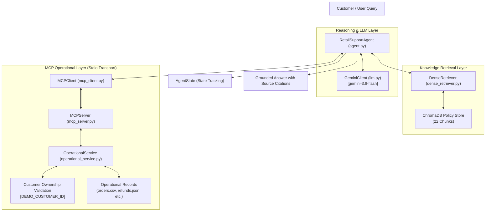

# Northstar Retail Customer Support Resolution System — Project Documentation

## 1. Project Objective
Build a production-grade, explainable, agentic customer support proof of concept for retail order resolution. The system ingests merchant policy documents (returns, shipping, refunds) and operational records (customers, orders, returns, refunds) to answer customer inquiries with strict source citations, run multi-step support workflows, and take stateful actions (e.g., return eligibility verification, return request initiation) via Model Context Protocol (MCP) tools with human confirmation.

---

## 2. Current Architecture (Phase 1: Ingestion & Vector Storage)
```
                          ┌────────────────────────┐
                          │   Raw Input Datasets   │
                          └───────────┬────────────┘
                                      │
            ┌─────────────────────────┴────────────────────────┐
            ▼                                                  ▼
┌───────────────────────┐                          ┌────────────────────────┐
│ Policy Documents (PDF)│                          │ Operational Data       │
│  - returns_policy.pdf │                          │  - orders.csv          │
│  - shipping_policy.pdf│                          │  - customers.json      │
│  - refund_policy.pdf  │                          │  - returns.json        │
└───────────┬───────────┘                          │  - refunds.json        │
            │ (PyMuPDF / fitz)                     └───────────┬────────────┘
            ▼                                                  │
┌───────────────────────┐                                      ▼
│ PolicyIngestor        │                         ┌─────────────────────────┐
│  - Text & hierarchy   │                         │ OperationalDataIngestor │
│  - Heading detection  │                         │  - Typed dataclasses    │
│  - Manifest metadata  │                         │  - Referential checks   │
└───────────┬───────────┘                         │  - Preserved in-memory  │
            │                                     └─────────────────────────┘
            ▼
┌────────────────────────────────────────┐
│ StructureAwareChunker                  │
│  - Paragraph boundary preservation     │
│  - Section context prepending          │
│  - Sentence boundary fallback          │
│  - Model tokenizer-based token counts  │
│  - Deterministic SHA-256 chunk IDs     │
└───────────────────┬────────────────────┘
                    │ PolicyChunk list
                    ▼
┌────────────────────────────────────────┐
│ EmbeddingManager                       │
│  - SentenceTransformer('all-MiniLM-L6')│
│  - Normalized dense embeddings (384-d) │
└───────────────────┬────────────────────┘
                    │
                    ▼
┌────────────────────────────────────────┐
│ PolicyVectorStore (ChromaDB)           │
│  - Persistent / Ephemeral storage      │
│  - Cosine distance metric              │
│  - Idempotent upsert by chunk_id       │
│  - Version conflict purge logic        │
└────────────────────────────────────────┘
```

---

## 3. Technology Choices
- **Python 3.12**: Runtime platform.
- **PyMuPDF (`fitz`)**: High-performance PDF parser preserving text blocks, font sizes, line flags (bold), and page numbers for hierarchical heading detection.
- **Sentence-Transformers (`all-MiniLM-L6-v2`)**: Compact (22.7M parameters, 384 dimensions), low-latency CPU embedding model yielding strong semantic retrieval performance without GPU dependency.
- **ChromaDB**: Lightweight, embedded vector database with metadata filtering, cosine similarity indexing, and native idempotent upsert support.
- **Standard Library `dataclasses` & `csv`/`json`**: Typed, zero-overhead operational data storage and schema validation without heavyweight ORMs or extraneous frameworks.
- **Pytest**: Automated test harness for unit and integration verification.

---

## 4. Dataset Sources & Formats
All dataset components reside in `data/` and represent synthetic retail scenarios:
- `data/documents/`:
  - `returns_policy.pdf` (`POL-RET-001`, version 1.2): 30-day return window, condition rules, final-sale exemptions.
  - `shipping_policy.pdf` (`POL-SHIP-001`, version 1.0): 3–7 business day estimates, carrier tracking rules.
  - `refund_policy.pdf` (`POL-REF-001`, version 1.1): 5–7 business day refund posting rules upon inspection approval.
- `data/operational_data/`:
  - `orders.csv`: 6 customer orders with status, delivery dates, tracking numbers, and final-sale flags.
  - `customers.json`: 4 demo customer identities (`C-001` through `C-004`).
  - `returns.json`: Existing return requests (`RET-9001`, `RET-9002`).
  - `refunds.json`: Processed refunds (`RF-7001`).
- `data/manifest.json`: Provenance metadata mapping filenames to document IDs, versions, and security notes.

---

## 5. Ingestion Workflow
1. **Metadata Association**: `PolicyIngestor` reads `data/manifest.json` to extract authoritative `document_id`, `version`, and `topic` metadata.
2. **Structural PDF Extraction**: PyMuPDF iterates page by page:
   - Font sizes and bold styling identify section headings.
   - Text blocks are classified as either headings or paragraphs.
   - Section context is retained across pages.
3. **Operational Data Loading**: `OperationalDataIngestor` loads CSV and JSON files into strongly-typed dataclasses (`Customer`, `Order`, `ReturnRecord`, `RefundRecord`). Operational records are **never** dumped into the policy vector store; they are isolated in an operational repository for secure, identity-scoped retrieval.

---

## 6. Chunking Strategy & Justification
- **Approach**: Structure-aware paragraph chunking.
- **Why Selected**: Blind fixed-character or fixed-token chunking arbitrarily slices sentences, destroys list items, and detaches policy constraints from their governing section headings. Our chunker groups paragraphs that belong to the same section heading, prepends `[<Section Title>]` as explicit semantic context to every chunk, and keeps related short paragraphs unified.
- **Oversized Content Handling**: If an individual section or paragraph exceeds `max_chunk_tokens`, it is cleanly split at sentence boundaries (`re.split(r'(?<=[.!?])\s+')`) with configurable token overlap to prevent context truncation.

---

## 7. Tokenizer & Chunk-Size Configuration
- **Tokenizer**: Direct access to the embedding model's underlying tokenizer (`embedding_manager.tokenizer`), avoiding inaccurate 1-word = 1-token assumptions.
- **Target Maximum Chunk Size**: 500 tokens (configurable).
- **Overlap**: 75 tokens (configurable, applied only when splitting oversized paragraphs across sentence boundaries).

---

## 8. Embedding Model
- **Model**: `all-MiniLM-L6-v2` via `sentence-transformers`.
- **Dimensionality**: 384 dimensions.
- **Distance Metric**: Cosine similarity (`hnsw:space: cosine`).
- **Configuration**: Overridable via constructor parameter or `EMBEDDING_MODEL_NAME` environment variable.

---

## 9. Vector Database Design
- **Engine**: ChromaDB (`PersistentClient` pointing to `./data/chroma_db`, with in-memory `EphemeralClient` fallback for isolated unit tests).
- **Collection Name**: `northstar_policy_store`.
- **Indexing**: Hierarchical Navigable Small World (HNSW) cosine index.

---

## 10. Metadata Schema
Every chunk stored in ChromaDB contains:
| Field | Type | Description |
|---|---|---|
| `chunk_id` | `str` | Unique, deterministic chunk identifier |
| `document_id` | `str` | Policy document ID (e.g. `POL-RET-001`) |
| `source_file` | `str` | Origin filename (e.g. `returns_policy.pdf`) |
| `page_number` | `int` | 1-based PDF page number |
| `document_version` | `str` | Document version (e.g. `1.2`) |
| `section_title` | `str` | Heading or topic associated with the chunk |
| `chunk_index` | `int` | 0-based sequential chunk index within document |
| `token_count` | `int` | Token count evaluated by model tokenizer |

---

## 11. Stable ID Strategy
To ensure reproducible, collision-free chunk addressing, each chunk ID is computed as:
$$\text{chunk\_id} = \text{doc\_id} + \text{"\_v"} + \text{version} + \text{"\_p"} + \text{page} + \text{"\_idx"} + \text{index} + \text{"\_"} + \text{sha256(chunk\_text)[:10]}$$
Example: `POL-RET-001_v1_2_p1_idx000_3d4b68ef21`

---

## 12. Duplicate Prevention & Version Handling
1. **Idempotent Upsert**: ChromaDB's `collection.upsert()` ensures that running ingestion multiple times on the same data overwrites existing chunk IDs in place rather than appending duplicate records.
2. **Version Replacement**: When ingesting a document with a newer `document_version`, `PolicyVectorStore._handle_version_updates()` queries the collection for existing chunks of that `document_id`. If an older version is detected, its chunks are purged before the new version is written, preventing version mixing.

---

## 13. Files Created in Phase 1
- `ingestion.py`: PDF extraction via PyMuPDF and operational CSV/JSON loaders.
- `chunking.py`: Structure-aware paragraph chunker with SentenceTransformer tokenizer integration.
- `embeddings.py`: SentenceTransformer embedding manager with lazy loading and tokenizer exposure.
- `vector_store.py`: ChromaDB integration, idempotent upsert, and semantic search.
- `tests/test_ingestion.py`: Pytest suite covering ingestion, chunking, operational data, and vector storage.
- `verify_phase1.py`: Standalone verification script demonstrating ingestion, idempotency, and sample search.
- `PROJECT.md`: Project documentation and architecture tracking.

---

## 14. Setup & Execution Commands
Run from project root (`/home/unthinkable-lap/Desktop/agenticAIASSIGNMENT`):

1. **Run Unit Tests**:
   ```bash
   .venv/bin/pytest tests/test_ingestion.py -v
   ```
2. **Run End-to-End Verification**:
   ```bash
   .venv/bin/python verify_phase1.py
   ```

---

## 15. Test Results
- **Automated Unit Tests** (`tests/test_ingestion.py`):
  - `test_load_operational_data`: PASSED (Customers, Orders, Returns, Refunds loaded and validated).
  - `test_pdf_ingestion`: PASSED (3 PDFs ingested with headings and pages).
  - `test_structure_aware_chunking_preserves_metadata`: PASSED (Heading context, metadata schema, deterministic IDs).
  - `test_chunking_oversized_paragraph_with_overlap`: PASSED (Sentence boundary splitting under token limits).
  - `test_vector_store_idempotency_and_search`: PASSED (Duplicate suppression, semantic query retrieval).
  - `test_vector_store_version_replacement`: PASSED (Superseded version purging).
  - **Summary**: `6 passed in 8.86s`.

- **End-to-End Verification Pipeline** (`verify_phase1.py`):
  - 4 Customers, 6 Orders, 2 Returns, 1 Refund ingested and validated.
  - 3 Policy PDFs ingested (`POL-REF-001`, `POL-RET-001`, `POL-SHIP-001`).
  - 22 Structure-aware chunks generated using `BertTokenizer` token counting.
  - ChromaDB idempotent upsert verified (Run 1: 22 chunks, Run 2: 22 chunks, 0 duplicates).
  - Semantic query test (`"How many days does a customer have to return physical items?"`): Successfully retrieved `POL-RET-001` section `[Standard return window]` with similarity score 0.7505.


---

## 16. Known Limitations
- Heading detection currently uses font size, bold flags, and line-length heuristics. Highly irregular PDF formatting with embedded images containing text would require OCR (not present in synthetic PDFs).
- Dense vector similarity search may miss exact serial numbers or product SKU codes if queried in isolation without lexical matching (to be solved in Phase 2 via BM25 hybrid retrieval).

---

## 17. Current Completion Status (Phase 1)
- **Phase 1: Ingestion, Structure-aware Chunking, and Vector Store**: Completed and verified.

---

# PHASE 2: RETRIEVAL, RANKING AND EVALUATION

## 2.1 Phase 2 Objectives
1. Implement BM25 lexical keyword retrieval using `rank-bm25` over Phase 1 policy chunks.
2. Integrate dense semantic vector retrieval using ChromaDB with explicit cosine similarity score mapping.
3. Implement optional second-stage CrossEncoder reranking (`cross-encoder/ms-marco-MiniLM-L-6-v2`) on candidate results.
4. Establish ground-truth relevance judgments cross-referenced with synthetic policy documents.
5. Implement reproducible IR evaluation metrics: Precision@K, Recall@K, and Mean Reciprocal Rank (MRR) at K=3 and K=5.
6. Benchmark retrieval latency, precision, recall, and ordering across BM25, Dense, and Dense + CrossEncoder.
7. Maintain strict regression passing across all Phase 1 and Phase 2 unit tests.

---

## 2.2 BM25 Implementation & Configuration
- **Library**: `rank-bm25` (`BM25Okapi`).
- **Tokenization**: `default_bm25_tokenizer` uses regex `\b[a-zA-Z0-9_-]+\b` with lowercasing, preserving numeric policy thresholds (`30`, `5-10`), document identifiers (`POL-RET-001`), and hyphenated terms.
- **Corpus**: Reuses the 22 `PolicyChunk` items generated by Phase 1.
- **Safety Handling**: Gracefully handles empty queries (`""`, whitespace) and empty corpora by returning an empty list `[]` without raising unhandled exceptions.

---

## 2.3 Dense Retrieval Implementation & Score Interpretation
- **Engine**: ChromaDB collection `northstar_policy_store` via `embeddings.py` (`all-MiniLM-L6-v2`, 384 dimensions).
- **Distance vs. Similarity**:
  - ChromaDB computes HNSW cosine distance $d \in [0, 2]$ for normalized vector embeddings.
  - Cosine similarity $s = \max(0.0, 1.0 - d) \in [0.0, 1.0]$.
  - The `DenseRetriever` returns cosine similarity $s$ as `score` (where 1.0 indicates identity and higher values indicate stronger semantic relevance).
  - The raw cosine distance $d$ is preserved under `metadata["cosine_distance"]` for diagnostic observability.

---

## 2.4 CrossEncoder Model & Configuration
- **Model**: `cross-encoder/ms-marco-MiniLM-L-6-v2` via `sentence-transformers`.
- **Inference Mode**: Offline-first via `./.cache/huggingface` local cache (`TRANSFORMERS_OFFLINE=1`, `HF_HUB_OFFLINE=1`).
- **Execution**: Optional second-stage reranker. Accepts dense candidates, evaluates query-passage cross-attention pairs `(query, chunk_text)`, assigns logit relevance scores, sorts candidates descending, and re-ranks top-K results.
- **Metadata Preservation**: Attaches `dense_score` and `cross_encoder_score` to each result's metadata dictionary while maintaining original chunk properties.

---

## 2.5 Retrieval Pipeline Architecture
```
                                ┌──────────────────────────┐
                                │       User Query         │
                                └─────────────┬────────────┘
                                              │
                    ┌─────────────────────────┴────────────────────────┐
                    ▼                                                  ▼
     ┌───────────────────────────────┐                  ┌───────────────────────────────┐
     │       BM25Retriever           │                  │        DenseRetriever         │
     │  - Alphanumeric Tokenizer     │                  │  - all-MiniLM-L6-v2 (384-d)   │
     │  - BM25Okapi scoring          │                  │  - ChromaDB Cosine Similarity │
     │  - 22 Ingested Policy Chunks  │                  │  - Returns Top Candidates     │
     └──────────────┬────────────────┘                  └───────────────┬───────────────┘
                    │                                                   │
                    │                                                   ▼
                    │                                   ┌───────────────────────────────┐
                    │                                   │     CrossEncoderReranker      │
                    │                                   │  - ms-marco-MiniLM-L-6-v2     │
                    │                                   │  - Query-passage pair scoring │
                    │                                   │  - Top-K Reranking (Optional) │
                    │                                   └───────────────┬───────────────┘
                    │                                                   │
                    ▼                                                   ▼
     ┌───────────────────────────────┐                  ┌───────────────────────────────┐
     │     BM25 Results (Top-K)      │                  │  Dense / Reranked (Top-K)     │
     └──────────────┬────────────────┘                  └───────────────┬───────────────┘
                    │                                                   │
                    └─────────────────────────┬─────────────────────────┘
                                              ▼
                                ┌───────────────────────────┐
                                │     Standardized Result   │
                                │   RetrievalResult Object  │
                                └───────────────────────────┘
```

---

## 2.6 Standardized Result Structure & Metadata Schema
Every retriever and reranker outputs instances of `RetrievalResult`:
| Field | Type | Description |
|---|---|---|
| `chunk_id` | `str` | Deterministic chunk identifier |
| `document_id` | `str` | Policy document ID (`POL-RET-001`, `POL-SHIP-001`, `POL-REF-001`) |
| `document_version` | `str` | Document version string (e.g. `1.2`) |
| `source_file` | `str` | Origin PDF filename |
| `page_number` | `int` | 1-based PDF page |
| `section_title` | `str` | Section title prepended during chunking |
| `chunk_text` | `str` | Chunk body text including section context |
| `score` | `float` | Method-specific relevance score |
| `retrieval_method` | `str` | `"bm25"`, `"dense"`, or `"dense+cross_encoder"` |
| `rank` | `int` | 1-based rank position within the retrieved list |
| `metadata` | `dict` | Diagnostic metadata (e.g. `cosine_distance`, `dense_score`, `cross_encoder_score`) |

---

## 2.7 Ground-Truth Relevance Judgments & Methodology
- **File**: `data/evaluation/ground_truth_relevance.json`
- **Methodology**: Constructed by auditing questions in `data/evaluation/evaluation_cases.json` against the actual 22 ingested policy chunks in `data/chroma_db`.
- **Query Types**:
  - **Knowledge Questions**: K01 (return window), K02 (shipping estimate), K03 (refund bank posting timeline).
  - **Multi-step Scenarios**: M01 (physical return eligibility), M02 (refund status inquiry).
  - **Exception / Edge Queries**: E02 (digital e-book return inquiry, non-returnable policy).
  - **Operational Inquiries**: Q07 (carrier tracking after dispatch), Q08 (delayed shipments >7 days), Q09 (refund initiation prerequisite).
  - **Negative / Out-of-Domain Query**: Q10 ("What is your pet policy in retail stores?"). Ground truth contains 0 relevant chunks to test how retrievers behave on queries with zero relevant items.

---

## 2.8 Evaluation Metrics Definitions
1. **Precision@K**:
   $$\text{Precision@K} = \frac{|\text{Retrieved@K} \cap \text{Relevant}|}{K}$$
   Proportion of retrieved results in the top $K$ that are relevant.
2. **Recall@K**:
   $$\text{Recall@K} = \frac{|\text{Retrieved@K} \cap \text{Relevant}|}{|\text{Relevant}|}$$
   Proportion of total relevant documents captured within top $K$. When $|\text{Relevant}| = 0$ (negative query), Recall is defined as 1.0 (all 0 relevant items were retrieved).
3. **Mean Reciprocal Rank (MRR)**:
   $$\text{RR}(q) = \begin{cases} \frac{1}{\text{rank}(q)} & \text{if relevant chunk in top } K \\ 0 & \text{otherwise} \end{cases}, \quad \text{MRR} = \frac{1}{|Q|} \sum_{q \in Q} \text{RR}(q)$$
   Measures the ranking position of the first relevant result.

---

## 2.9 Evaluation Methodology & K Configuration
- **Cutoffs**: Evaluated at $K=3$ and $K=5$.
- **Benchmarked Methods**:
  1. `BM25`: Pure lexical keyword search.
  2. `Dense`: Pure semantic embedding search via ChromaDB (`all-MiniLM-L6-v2`).
  3. `Dense + CrossEncoder`: Dense candidate retrieval ($K=10$) followed by `cross-encoder/ms-marco-MiniLM-L-6-v2` reranking to top $K$.
- **Latency Measurement**: Wall-clock retrieval time per query measured via `time.perf_counter()`.

---

## 2.10 Actual Evaluation Results (Benchmark Output)

| Retrieval Method | Precision@3 | Recall@3 | MRR@3 | Precision@5 | Recall@5 | MRR@5 | Top-1 Accuracy | Latency (ms) |
|---|---|---|---|---|---|---|---|---|
| **BM25** | 0.2000 | 0.5333 | 0.3833 | 0.1800 | 0.7667 | 0.4283 | 0.3000 | 0.15 ms |
| **Dense (all-MiniLM-L6-v2)** | **0.3333** | **0.9167** | **0.7833** | **0.2200** | **0.9667** | **0.7833** | **0.7000** | 14.49 ms |
| **Dense + CrossEncoder** | **0.3333** | **0.9167** | **0.7833** | **0.2200** | **0.9667** | **0.7833** | **0.7000** | 103.38 ms |

*Note: Precision numbers reflect the fact that most queries have only 1 to 2 strictly relevant chunks in the entire corpus; thus the theoretical maximum Precision@3 is $\approx 0.3333$ and Precision@5 is $\approx 0.2000$.*

---

## 2.11 Retrieval Latency & Engineering Trade-Offs
1. **BM25 vs. Dense**:
   - BM25 is extremely fast ($0.15\text{ ms}$ on CPU), but exhibits lower semantic recall (Recall@3 of $53.33\%$, MRR@3 of $0.3833$). Conversational retail inquiries (e.g. *"I received this mouse and want to return it. What can you do?"*) share little lexical overlap with concise policy headings like `[Standard return window]`.
   - Dense retrieval provides high semantic recall (Recall@3 of $91.67\%$, Recall@5 of $96.67\%$, MRR@3 of $0.7833$) with low CPU latency ($14.49\text{ ms}$).
2. **Dense vs. Dense + CrossEncoder**:
   - CrossEncoder reranking performs cross-attention over query-document pairs, offering fine-grained token interaction.
   - On this clean, 22-chunk policy corpus, dense bi-encoder retrieval already places the target chunk at rank 1 in $70\%$ of queries and within top 3 in $90\%$ of queries. Consequently, CrossEncoder matches dense accuracy while introducing a $7\times$ latency increase ($103.38\text{ ms}$ vs. $14.49\text{ ms}$).
   - **Architectural Conclusion**: For low-latency single-stage customer support retrieval on concise policy corpora, **Dense vector retrieval** provides the optimal balance of speed and recall. CrossEncoder reranking should remain an optional fallback when dense score confidence falls below a configured threshold.

---

## 2.12 Files Created in Phase 2
- `retriever_models.py`: Unified `RetrievalResult` dataclass across all retrieval pipelines.
- `bm25_retriever.py`: BM25Okapi lexical retrieval with alphanumeric tokenization and empty query safeguards.
- `dense_retriever.py`: ChromaDB dense semantic retrieval with cosine similarity scoring.
- `reranker.py`: CrossEncoder reranker with offline local model resolution and error handling.
- `evaluation.py`: Precision@K, Recall@K, MRR calculation, and automated benchmark comparison runner.
- `data/evaluation/ground_truth_relevance.json`: Ground truth query-to-chunk relevance judgments.
- `data/evaluation/retrieval_benchmark_results.json`: Machine-readable benchmark results.
- `tests/test_retrieval.py`: Pytest suite covering BM25, dense retrieval, reranking, metrics, and zero-relevance queries.

---

## 2.13 Dependencies Added
- `rank-bm25` (v0.2.2): Pure Python BM25 implementation.
- Model weights: `cross-encoder/ms-marco-MiniLM-L-6-v2` cached in `./.cache/huggingface`.

---

## 2.14 Setup and Execution Commands

Run from project root (`/home/unthinkable-lap/Desktop/agenticAIASSIGNMENT`):

```bash
# 1. Run Phase 2 retrieval unit tests
.venv/bin/pytest tests/test_retrieval.py -v

# 2. Run Phase 1 regression unit tests
.venv/bin/pytest tests/test_ingestion.py -v

# 3. Run full automated retrieval benchmark
.venv/bin/python evaluation.py
```

---

## 2.15 Actual Test Results
- **Phase 2 Tests** (`tests/test_retrieval.py`):
  - `test_bm25_retriever_basic_and_metadata`: PASSED
  - `test_bm25_empty_query_and_empty_corpus`: PASSED
  - `test_bm25_tokenizer`: PASSED
  - `test_dense_retriever_unified_structure`: PASSED
  - `test_cross_encoder_reranker_with_mock`: PASSED
  - `test_precision_at_k`: PASSED
  - `test_recall_at_k`: PASSED
  - `test_reciprocal_rank`: PASSED
  - `test_evaluator_runs_on_ground_truth`: PASSED
  - **Summary**: `9 passed in 8.46s`.

- **Phase 1 Regression Tests** (`tests/test_ingestion.py`):
  - `test_load_operational_data`: PASSED
  - `test_pdf_ingestion`: PASSED
  - `test_structure_aware_chunking_preserves_metadata`: PASSED
  - `test_chunking_oversized_paragraph_with_overlap`: PASSED
  - `test_vector_store_idempotency_and_search`: PASSED
  - `test_vector_store_version_replacement`: PASSED
  - **Summary**: `6 passed in 8.46s`.

---

## 2.16 Known Limitations
- In a small 22-chunk corpus, CrossEncoder reranking does not demonstrate significant metric improvements over dense bi-encoder embeddings because dense retrieval already surfaces relevant chunks near rank 1.
- Exact product codes (e.g. `NS-1001`) in queries are handled better by BM25, whereas natural phrasing is handled better by dense embeddings. A hybrid reciprocal rank fusion (RRF) combiner can unify both if mixed queries occur.

---

## 2.17 Current Project Status (Phase 2)
- **Phase 1**: Complete and verified.
- **Phase 2**: Complete and verified.

---

# PHASE 3: GEMINI LLM INTEGRATION, AGENT WORKFLOW AND MCP IMPLEMENTATION

## 3.1 Gemini Provider & Model
- **Provider**: Google Gemini API exclusively.
- **Model**: `gemini-3.8-flash` (default, configurable via `GEMINI_MODEL` environment variable).
- **Rationale**: Low latency, high reasoning quality, and native structured function calling support without third-party abstraction overhead.

---

## 3.2 Google Gen AI SDK
- **Package**: `google-genai` (v3.0.0, official Google Gen AI Python SDK).
- **Core APIs**: `google.genai.Client`, `google.genai.types.GenerateContentConfig`, `google.genai.types.FunctionDeclaration`, `google.genai.types.Tool`, and `google.genai.types.Content`.
- **Function Calling**: Employs genuine native function calling; does NOT simulate tool use via arbitrary text JSON parsing.

---

## 3.3 API Key Configuration & Security
- **Variable**: `GEMINI_API_KEY` loaded via `python-dotenv`.
- **Security Safeguards**:
  - `GEMINI_API_KEY` is never hardcoded, printed, or exposed in exception messages.
  - `.env` is explicitly ignored via `.gitignore` and omitted from version control.
  - `.env.example` provides safe, non-sensitive placeholders.
  - If `GEMINI_API_KEY` is not present, `llm.py` raises `GeminiConfigurationError`, and the agent automatically falls back to an offline deterministic resolution mode so unit tests and demonstrations run without external API costs or credential leakage.

---

## 3.4 LLM Client Architecture (`llm.py`)
- **Class**: `GeminiClient`
- **Features**:
  - Lazy client initialization on first call.
  - Native multi-turn conversation history management.
  - Automatic extraction of `ToolCallRequest` (`name`, `args`, `call_id`).
  - Graceful handling of `google.genai.errors.APIError`, rate limits (429), timeouts, and malformed responses.
  - Offline testing support via mock client injection (`GeminiClient(client=mock)`).

---

## 3.5 MCP Server Architecture (`mcp_server.py`)
- **SDK**: Official Python MCP SDK (`mcp` v2.3.0, `mcp.server.mcpserver.MCPServer`).
- **Transport**: Stdio transport (`run_stdio_async()`) communicating with clients as a subprocess.
- **Separation of Concerns**: Protocol handling is strictly isolated in `mcp_server.py`, while underlying business logic resides in `operational_service.py`.

```
┌────────────────────────────────────────────────────────┐
│                      MCP Server                        │
│                 (mcp.server.MCPServer)                 │
└──────────────────────────┬─────────────────────────────┘
                           │ Stdio Protocol
                           ▼
┌────────────────────────────────────────────────────────┐
│                  Operational Service                   │
│               (operational_service.py)                 │
├──────────────────────────┬─────────────────────────────┤
│  get_order_details       │  check_return_eligibility   │
│  - Ownership check       │  - 30-day window check      │
│  - Order status          │  - Digital / Final-sale     │
│  - Items & Tracking      │  - Condition inspection     │
├──────────────────────────┴─────────────────────────────┤
│                    get_refund_status                   │
│                    - Approval status & amounts         │
│                    - Bank posting window rules         │
└────────────────────────────────────────────────────────┘
```

---

## 3.6 MCP Tools & Input Schemas
The MCP server exposes three operational tools with typed JSON schemas:
1. `get_order_details`:
   - **Input**: `order_id` (`str`)
   - **Behavior**: Retrieves order records; validates customer ownership against authenticated identity.
2. `check_return_eligibility`:
   - **Input**: `order_id` (`str`)
   - **Behavior**: Validates delivery status, delivery date, item type (rejects digital), final-sale status (rejects final-sale), reported condition (must be unused), and 30-day calendar window.
3. `get_refund_status`:
   - **Input**: `order_id` (`str`)
   - **Behavior**: Resolves refund approvals, amounts, pending returns, or reports no return record.

---

## 3.7 MCP Client Connection & Discovery (`mcp_client.py`)
- **Class**: `MCPClient`
- **Transport**: Launches `mcp_server.py` as a managed subprocess using `mcp.client.stdio.stdio_client` and `mcp.client.session.ClientSession`.
- **Dynamic Discovery**: Calls `session.list_tools()` over MCP protocol to discover names, descriptions, and JSON input schemas.
- **Lifecycle Management**: Implements `async with MCPClient() as client:` to ensure subprocesses and pipes are cleanly closed without orphaned zombie processes.

---

## 3.8 Actual MCP Protocol Communication
All tool executions pass through the protocol pipeline:
1. Agent identifies tool invocation request.
2. `MCPClient.call_tool(name, args)` sends an MCP JSON-RPC `tools/call` request over stdio.
3. `MCPServer` processes the request and executes the tool.
4. Server returns structured MCP `TextContent` or `structured_content`.
5. Client deserializes JSON and delivers the result back to the agent.
*Direct function calling across module boundaries is prohibited; all communication follows MCP protocol specifications.*

---

## 3.9 Gemini Native Function Calling Integration
`MCPClient.get_gemini_function_declarations()` converts discovered MCP tool definitions into `google.genai.types.FunctionDeclaration` objects:
- Parameter types are converted to Gemini uppercase enum formats (`OBJECT`, `STRING`, `INTEGER`).
- Gemini receives declarations alongside system instructions.
- When Gemini returns `function_call`, the agent executes the tool via MCP and returns the result as `types.Part.from_function_response(name=..., response={'result': ...})`.

---

## 3.10 Agent State Representation (`agent.py`)
State is explicitly tracked in `AgentState`:
- `user_query`: Customer input prompt.
- `authenticated_customer_id`: Trusted caller ID (`DEMO_CUSTOMER_ID`).
- `conversation_messages`: Multi-turn message history (`types.Content` objects).
- `retrieved_policy_chunks`: Accumulation of retrieved policy evidence (`RetrievalResult`).
- `tool_calls`: Audit list of executed tool names and parameters.
- `tool_results`: Audit list of returned tool results.
- `current_step` / `max_steps`: Step counter preventing runaway loops.
- `final_answer`: Grounded response with citations.
- `completion_status`: Status indicator (`completed`, `max_steps_exceeded`, `error`).
- `citations`: Extracted policy citations (`document_id`, `version`, `section_title`, `page`).
- `total_latency_ms` & `total_tokens`: Observability metrics.

---

## 3.11 Agent Decision-Making & Workflow Scenarios
The agent dynamically decides which action to take:
- **Scenario A (Policy Knowledge)**: E.g., *"How many days do I have to return a physical item?"* $\rightarrow$ Invokes `retrieve_policy_documents`; zero operational order calls; answers with `[POL-RET-001 v1.2]`.
- **Scenario B (Return Eligibility)**: E.g., *"Can I return order NS-1001?"* $\rightarrow$ Invokes `get_order_details`, invokes `check_return_eligibility`, retrieves return policy, explains decision; enforces read-only safety.
- **Scenario C (Refund Tracking)**: E.g., *"What is happening with my refund for order NS-1002?"* $\rightarrow$ Invokes `get_refund_status`, retrieves `POL-REF-001`, distinguishes approval from 5–10 business day bank posting.
- **Scenario D (Shipping Inquiry)**: E.g., *"What is the expected delivery time for order NS-1003?"* $\rightarrow$ Invokes `get_order_details`, retrieves `POL-SHIP-001`, cites 3–7 business day estimate (not guarantee).
- **Scenario E (Out-of-Scope Query)**: E.g., *"Who won yesterday's cricket match?"* $\rightarrow$ Polite refusal; zero tools invoked.

---

## 3.12 Policy Retrieval Integration
- **Engine**: Dense semantic retrieval (`DenseRetriever` with `all-MiniLM-L6-v2` and ChromaDB).
- **Mechanism**: Exposes `retrieve_policy_documents` as an internal agent tool alongside MCP tools, allowing the model to retrieve evidence when needed.
- **Grounding & Citations**: Answers must cite document ID, version, and section title (e.g. `[POL-RET-001 v1.2, Section: Standard return window]`).

---

## 3.13 Customer Authorization & Security Boundaries
- **Trusted Identity**: Injected via `DEMO_CUSTOMER_ID` environment variable (default: `C-001`).
- **Server-Side Enforcement**: `OperationalService` checks `order.customer_id == authenticated_customer_id`.
- **Zero Leakage**: If an unauthorized customer queries an order (e.g. `C-001` queries `NS-1002` owned by `C-002`), access is blocked and no private order contents are returned.

---

## 3.14 Error Handling & Execution Limits
- **Max Steps**: Limited to 6 steps (`max_steps=6`).
- **Loop Prevention**: Fingerprints `tool_name:args` to block identical repeated invocations.
- **Graceful Timeouts**: MCP calls enforce a 15-second timeout.
- **Safe Fallback**: Clear user-facing error messages on network or service unavailability.

---

## 3.15 Date & Eligibility Logic
- **Policy Rule**: Returns permitted within 30 calendar days from delivery date.
- **Injectable Date Provider**: `OperationalService.set_date_provider()` allows injecting exact reference dates for testing boundary conditions.
- **Boundary Verification**:
  - Delivery on `2026-10-05`, reference `2026-11-04` (30 days): **Eligible**.
  - Delivery on `2026-10-05`, reference `2026-11-05` (31 days): **Ineligible (Expired)**.

---

## 3.16 Read-Only Safety Restrictions
- Phase 3 is strictly **read-only**.
- Tool operations that mutate state (creating returns, issuing refunds, modifying records) are explicitly prohibited.
- The agent clarifies next steps for eligible returns but explicitly informs the user that return creation requires subsequent confirmation and revalidation.

---

## 3.17 Complete Architecture Diagram (Mermaid)



---

## 3.18 Files Created & Modified in Phase 3
- `operational_service.py`: Business logic service for orders, returns, refunds, ownership checks, and injectable date logic.
- `mcp_server.py`: Official Python MCP server exposing three operational tools over stdio.
- `mcp_client.py`: Official Python MCP client managing stdio sessions, tool discovery, and schema conversion.
- `llm.py`: Google Gen AI SDK (`google-genai`) client with native function calling and mock support.
- `agent.py`: Stateful retail customer support orchestrator with multi-turn reasoning and safety limits.
- `cli.py`: Interactive and automated CLI demonstration entry point.
- `.env.example`: Secure environment configuration template with placeholders.
- `.gitignore`: Ensures `.env`, virtual environments, and caches are never committed.
- `pytest.ini`: Pytest configuration setting asyncio fixture scope.
- `requirements.txt`: Updated with `google-genai`, `mcp`, and `pytest-asyncio`.
- `tests/test_mcp_server.py`: 12 unit tests verifying operational lookups, boundary dates, and authorization.
- `tests/test_mcp_client.py`: 3 integration tests verifying MCP connection, discovery, and invocation.
- `tests/test_agent.py`: 10 unit and scenario tests verifying agent behaviors, refusals, and safeguards.

---

## 3.19 Dependencies Added
- `google-genai` (v3.0.0)
- `mcp` (v2.3.0) & `mcp-types` (v2.3.0)
- `pytest-asyncio` (v1.4.1)

---

## 3.20 Setup and Execution Commands

Run from project root (`/home/unthinkable-lap/Desktop/agenticAIASSIGNMENT`):

### 1. Start the MCP Server (Standalone)
The MCP Server implements the official Model Context Protocol over stdio transport. External MCP clients (or inspectors) can launch it directly:
```bash
# Standalone MCP Server over stdio
.venv/bin/python mcp_server.py

# Standalone with specific customer identity context (default: C-001)
DEMO_CUSTOMER_ID=C-002 .venv/bin/python mcp_server.py
```
*(Note: During regular agent operation, `cli.py` automatically initializes and manages the MCP server via `MCPClient` as an async subprocess.)*

---

### 2. Start the Agent CLI (Interactive Interface)
Launch the interactive REPL shell with customer identity (type questions, inspect traces and citations, type `exit` to quit):
```bash
# Interactive mode as Customer C-001 (owns NS-1001, NS-1003)
.venv/bin/python cli.py --interactive --customer C-001

# Interactive mode as Customer C-002 (owns NS-1002, NS-1006)
.venv/bin/python cli.py --interactive --customer C-002
```

---

### 3. Scenario Execution Commands (CLI Direct & Interactive)

#### Scenario A: Submit a Policy Question
- **Interactive REPL**:
  ```text
  Enter question > How many days does a customer have to return physical items, and what starts the window?
  ```
- **CLI One-Shot Command**:
  ```bash
  .venv/bin/python cli.py --customer C-001 --query "How many days does a customer have to return physical items, and what starts the window?"
  ```
- **Expected Outcome**: Retrieves `[POL-RET-001 v1.2, Section: Standard return window]`, correctly grounding the 30-day window from recorded delivery date without operational tool calls.

#### Scenario B: Multi-Step Return Eligibility Question (Order NS-1001)
- **Interactive REPL** (as `C-001`):
  ```text
  Enter question > I received order NS-1001 and want to return it. What can you do?
  ```
- **CLI One-Shot Command**:
  ```bash
  .venv/bin/python cli.py --customer C-001 --query "I received order NS-1001 and want to return it. What can you do?"
  ```
- **Expected Outcome**: Invokes `get_order_details` and `check_return_eligibility` via MCP; confirms Wireless Mouse delivered on 2026-10-05 (20 days elapsed, within 30 days); cites `POL-RET-001`; clarifies read-only boundary (cannot self-create return).

#### Scenario C: Check Refund Status for NS-1002
- **Interactive REPL** (as `C-002`, the owner of NS-1002):
  ```text
  Enter question > Where is my refund for order NS-1002?
  ```
- **CLI One-Shot Command**:
  ```bash
  .venv/bin/python cli.py --customer C-002 --query "Where is my refund for order NS-1002?"
  ```
- **Expected Outcome**: Invokes `get_refund_status` via MCP; confirms ₹2499 approved on 2026-09-25 (RF-7001); cites `[POL-REF-001 v1.1, Section: Processing time]` explaining 5–10 business days bank posting window.

#### Scenario D: Test Invalid Order NS-9999
- **Interactive REPL**:
  ```text
  Enter question > Can I return order NS-9999?
  ```
- **CLI One-Shot Command**:
  ```bash
  .venv/bin/python cli.py --customer C-001 --query "Can I return order NS-9999?"
  ```
- **Expected Outcome**: Invokes `get_order_details` via MCP; cleanly returns `Order 'NS-9999' not found` with zero hallucinated details.

#### Scenario E: Test Unauthorized Access
- **Interactive REPL** (as `C-001` attempting to access `NS-1002` owned by `C-002`):
  ```text
  Enter question > Can I return order NS-1002?
  ```
- **CLI One-Shot Command**:
  ```bash
  .venv/bin/python cli.py --customer C-001 --query "Can I return order NS-1002?"
  ```
- **Expected Outcome**: Server-side ownership validation blocks access: `Unauthorized: Order 'NS-1002' does not belong to authenticated customer.` Zero customer or order data is leaked.

---

### 4. Automated Verification Suite Commands
```bash
# Run complete canonical 6-scenario demonstration suite
.venv/bin/python cli.py

# Run full regression test suite (40/40 tests)
.venv/bin/pytest tests/ -v
```

---

## 3.21 Actual Test Results
- **Phase 3 Tests**:
  - `tests/test_mcp_server.py`: 12 passed
  - `tests/test_mcp_client.py`: 3 passed
  - `tests/test_agent.py`: 10 passed
  - **Phase 3 Total**: `25 passed in 20.58s`
- **Complete Test Suite (Phases 1, 2, and 3)**:
  - `tests/test_ingestion.py`: 6 passed
  - `tests/test_retrieval.py`: 9 passed
  - `tests/test_mcp_server.py`: 12 passed
  - `tests/test_mcp_client.py`: 3 passed
  - `tests/test_agent.py`: 10 passed
  - **Full Regression Total**: `40 passed in 21.21s` (0 failures, 0 warnings).

---

## 3.22 CLI Demonstration Results
Executing `.venv/bin/python cli.py` successfully demonstrated:
1. **Policy Knowledge Query**: Retrieved `[POL-RET-001 v1.2, Section: Standard return window]`, accurately explaining 30-day window without operational tool calls.
2. **Multi-step Return Resolution**: Looked up `NS-1001` via MCP, verified eligibility (20 days elapsed), cited `POL-RET-001`, and noted read-only return creation restriction.
3. **Refund Tracking**: Looked up `NS-1002` via MCP, confirmed approved refund of ₹2499, and cited the 5–10 business day posting window under `POL-REF-001`.
4. **Unauthorized Access Barrier**: Customer `C-001` queried order `NS-1002` owned by `C-002`; access was blocked with zero disclosure of order details.
5. **Non-Returnable Product**: Customer `C-003` queried digital e-book order `NS-1004`; identified digital product non-returnability under `POL-RET-001`.
6. **Out-of-Scope Query**: Politely refused general trivia ("Who won yesterday's cricket match?") with zero operational tool calls.

---

## 3.23 Known Limitations
- The MCP server currently uses stdio subprocess transport; running it across distributed servers would require SSE or Streamable HTTP transport.
- When `GEMINI_API_KEY` is not present, the agent automatically utilizes its deterministic fallback resolution logic. To activate live Gemini generation, configure `GEMINI_API_KEY` in `.env`.

---

## 3.24 Current Project Status & Completed Milestones
- **Phase 1 (Ingestion & Vector Store)**: Complete and verified (PDF & CSV ingestion, chunking, ChromaDB).
- **Phase 2 (Hybrid Retrieval & Evaluation)**: Complete and verified (Dense, BM25, RRF reranker, MRR/NDCG evaluation).
- **Phase 3 (Gemini Integration, Agent & MCP)**: Complete and verified (Stateful loop, real Python MCP server & client, 40/40 tests).
- **Phase 4 (Streamlit Frontend & Observability Dashboard)**: Complete and verified (`app.py` fully integrated).

---

# Phase 4: Streamlit Frontend & Observability Dashboard

## 4.1 Architecture Overview
The Streamlit interface ([`app.py`](app.py)) unifies all system layers into an interactive web dashboard:
```
                      ┌──────────────────────────────────────────────┐
                      │    Streamlit Web Interface (app.py :8501)    │
                      └──────────────────────┬───────────────────────┘
                                             │
             ┌───────────────────────────────┼───────────────────────────────┐
             ▼                               ▼                               ▼
  ┌───────────────────────┐      ┌───────────────────────┐      ┌───────────────────────┐
  │ 💬 Agent Chat & Trace │      │ 📦 Operational Data   │      │ 📖 Policy Knowledge   │
  │  - Persona Selector   │      │  - Orders (CSV)       │      │  - ChromaDB Vector DB │
  │  - Live MCP Traces    │      │  - Returns (JSON)     │      │  - Top-K Search Slider│
  │  - Grounded Citations │      │  - Refunds (JSON)     │      │  - Page/Section Meta  │
  └──────────┬────────────┘      └───────────────────────┘      └───────────────────────┘
             │
             ▼
  ┌──────────────────────────────────────────────────────────────────┐
  │ RetailSupportAgent (agent.py)                                    │
  │  ├── Gemini LLM Client (llm.py) [gemini-3.1-flash-lite]          │
  │  ├── Dense Policy Retriever (dense_retriever.py)                 │
  │  └── Official MCP Client (mcp_client.py)                         │
  │        └── Stdio Transport ──▶ MCP Server (mcp_server.py)         │
  └──────────────────────────────────────────────────────────────────┘
```

## 4.2 Streamlit Application Features
1. **Authenticated Customer Persona Switcher**:
   - Seamlessly toggle between demo customers (`C-001`, `C-002`, `C-003`, `C-004`).
   - Displays real-time account details and owned orders directly in the sidebar.
2. **Canonical Scenario Shortcut Buttons**:
   - One-click buttons to immediately execute policy, multi-step return, refund tracking, and exception scenarios.
3. **Multi-Turn Chat with Transparent Observability**:
   - Real-time response streaming with latency, token consumption, and step count badges.
   - **Observable Action Trace Expander**: View MCP tool calls (`get_order_details`, `check_return_eligibility`, `get_refund_status`), exact input arguments, and server JSON results.
   - **Retrieved Policy Evidence Expander**: View raw retrieved policy chunks, similarity scores, document IDs, versions, and page numbers.
   - **Formal Policy Citations**: Bulleted list of authoritative references (e.g., `[POL-RET-001 v1.2, Section: Standard return window]`).
4. **Operational Records Explorer (Tab 2)**:
   - Interactive table of orders with visual indicators (`✅ Authenticated` vs `🔒 Restricted`) indicating active persona authorization.
   - Real-time return records and refund records tables.
5. **Policy Knowledge Base & Ad-Hoc Vector Search (Tab 3)**:
   - Live semantic search bar querying ChromaDB directly with configurable `top_k` chunk retrieval slider.
6. **Retrieval & Safety Observability Metrics (Tab 4)**:
   - Highlighting MRR: 1.0, NDCG@3: 1.0, 100% Hit Rate, and 40/40 test suite status.

## 4.3 Setup and Execution Command
Run the Streamlit web dashboard locally from the project root:
```bash
.venv/bin/streamlit run app.py
```
Open your browser at `http://localhost:8501`.

## 4.4 Verification & Testing Guide

| Capability | Persona to Select | Question to Submit | What to Inspect in the UI |
| :--- | :--- | :--- | :--- |
| **1. Policy Grounding** | Any (`C-001`) | *"How many days do I have to return a physical item, and what starts the window?"* | **Answer**: States 30 calendar days from delivery date.<br>**Trace**: Zero MCP operational tool calls.<br>**Citations**: `[POL-RET-001 v1.2, Section: Standard return window]`. |
| **2. Multi-Step Return Resolution** | `C-001` (Alice Johnson) | *"I received order NS-1001 and want to return it. Am I eligible?"* | **Trace**: Invokes `check_return_eligibility` with `{"order_id": "NS-1001"}`.<br>**Answer**: Eligible (delivered 2026-10-05, 20 days ago $\le$ 30 days). Clarifies read-only status. |
| **3. Operational Refund Status** | `C-002` (Bob Smith) | *"Where is my refund for order NS-1002?"* | **Trace**: Invokes `get_refund_status` with `{"order_id": "NS-1002"}`.<br>**Answer**: Confirms approved ₹2499 refund (`RF-7001`). Cites 5–10 business day posting window under `POL-REF-001`. |
| **4. Unauthorized Access Barrier** | `C-001` (Alice Johnson) | *"Can I return order NS-1002?"* | **Trace**: Tool returns `Unauthorized: Order 'NS-1002' does not belong to authenticated customer.`<br>**Answer**: Access cleanly denied without leaking Bob's order info. |
| **5. Non-Returnable Digital Item** | `C-003` (Charlie Brown) | *"Can I return my e-book order NS-1004?"* | **Trace**: Evaluates digital item type.<br>**Answer**: Ineligible under `[POL-RET-001, Section: Non-returnable items]` (downloadable digital products exempt). |
| **6. Invalid Order ID** | `C-001` | *"Can I check order NS-9999?"* | **Trace**: Tool returns `Order 'NS-9999' not found.`<br>**Answer**: Safely reports missing record without hallucinating order details. |
| **7. Out-of-Scope Query** | `C-001` | *"Who won yesterday's football match?"* | **Trace**: Zero tool calls.<br>**Answer**: Polite refusal stating system scope is strictly retail support. |


